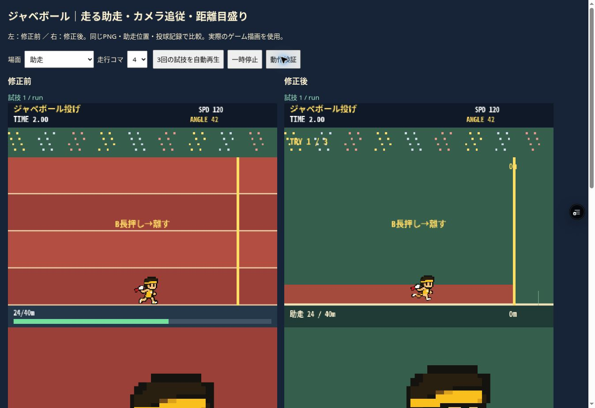
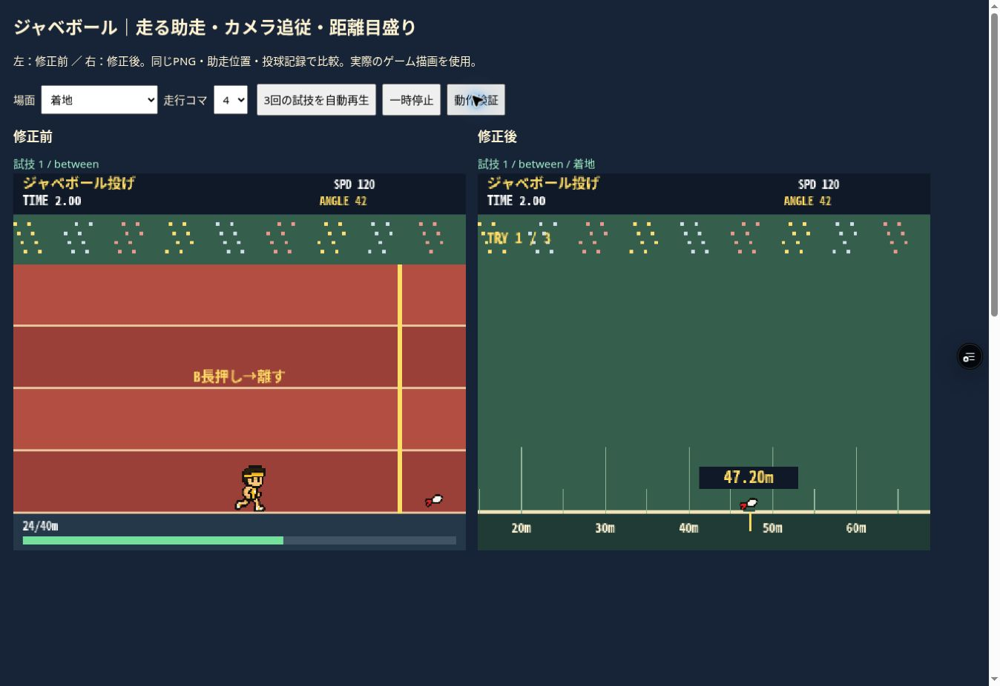

# ジャベボール：助走と着地点の追従

対象：feature/8bit-athletics-web-beta / games/athletics のみ。
ゲーム変更コミット：7b3b91aeb9250d6983b85b2addcba656b801e3c9。

## 原因と修正

- 助走中は構えPNGの1コマを固定表示していた。承認済みの構え・引き込みPNGの上半身と、承認済みsprint PNGの8コマの脚を、腰の位置で重ねて描画する。角度調整中も移動していれば脚が動き、停止時は構えに戻る。
- PNGファイル自体、顔、髪、輪郭、配色は変更なし。整数の切り出し・描画座標、補間無効を維持。
- 旧飛翔は記録に関係なく135px・1.2秒の固定演出だった。投球ラインを0m、1mを7.1pxとして、確定記録に対応する着地点へ飛ばす。
- 飛翔中はボールをカメラが追う。地面に5m刻みの目盛り、10m刻みの距離表示、着地点に小数2桁の記録を表示。
- 着地を1.2秒表示してから次の試技へ進む。飛翔と着地の表示時間はゲームの固定ステップで進め、実時間のdeadlineによる演出途中の打ち切りを防ぐ。
- 飛距離の算出式、入力、助走距離、3回の試技、得点、大会進行は維持。

## 確認

Vercel Preview READY（Productionではない）：
https://tokyo8games-h3lgnwe9x-tokyo8games.vercel.app/games/athletics/index.html

- クラウドChrome：実際のCanvasで助走・引き込み・飛行50%・着地を確認。通常のゲーム画面でもタイトル→種目選択→ガイド→A助走→B投球を操作。
- ブラウザの専用検証：28項目PASS。助走8コマ、引き込み中の8コマ、停止、整数描画、距離算出式、低速・高速・早期投球の追従、着地点との一致、着地後の表示、カメラリセット、3回の試技、最高記録。
- ブラウザの全競技検証：206項目PASS。旧版とレース記録・得点・大会合計が一致。
- Node＋native Canvas：同28項目、206項目、走行・スタート38項目PASS。Nodeの描画検証はブラウザ確認とは別。
- スマートフォン実機、端末エミュレーション、実スピーカーの音声は今回未確認。
- Vercel認証付きプレビュー。通常ログインで検証。一時的な認証回避リンクは発行していない。

比較画面（ゲーム本体を隔離実行し、記録を保存しない）：
https://tokyo8games-h3lgnwe9x-tokyo8games.vercel.app/games/athletics/tests/javeball.html

## 変更ファイル

- index.html：走行PNGの合成表示、追従カメラ、距離目盛り、着地表示と試技の切り替え。
- tests/probe.js：着地表示の終了を待つ回帰検証。
- tests/javeball.html、tests/javeball-probe.js：比較と28項目の検証。
- tests/javeball-baseline/index.html：直前版を比較用に固定。
- tests/node-checks.cjs、tests/evidence/jave-checks.json：ブラウザ以外での再現検証。
- 本報告とブラウザ比較画像2枚。
