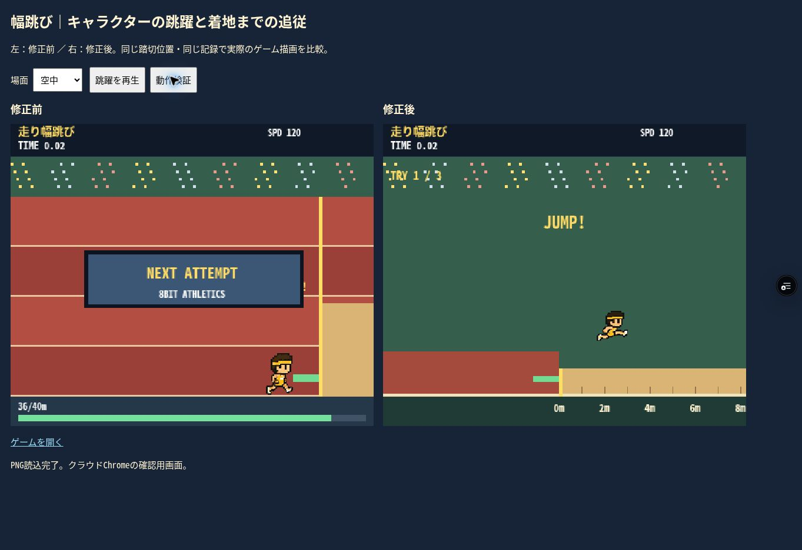
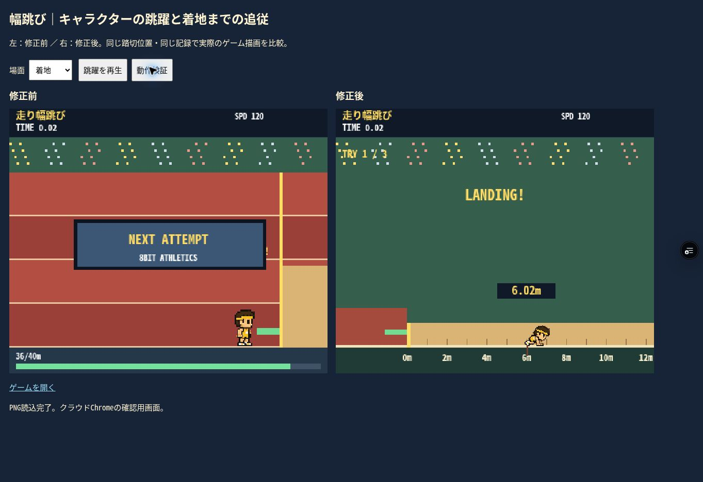

# 幅跳び：踏切から着地までの追従

対象：feature/8bit-athletics-web-beta / games/athletics。
実装：01dadb854c2a131257780b7f9e3a801d0d946116。
砂場の表示調整：7f53896790e12524ff35bf464f8b581eca8486af。

## 変更

旧版は踏切後も選手の座標が止まり、NEXT ATTEMPTの表示が跳躍を覆っていた。

- 承認済みPNGの踏切・空中姿勢・着地姿勢を使用し、選手を前方へ放物線状に移動する。新しいキャラクター生成やPNGの改変はしていない。
- カメラが選手を着地まで追従する。砂場の目盛りと着地位置を記録に対応させる。
- 着地ではしゃがみ、続いて立ち上がる。最初の接地位置に記録を表示し、1.2秒見せてから次の試技へ戻る。
- 踏切位置の32〜40判定、距離算出式、入力、3回の試技、最高記録、得点を維持。無効な踏切はファウルのまま、跳躍演出を行わない。
- 試技切り替えを固定ステップの経過時間で管理。着地前に実時間のdeadlineで演出が切れる問題を防ぐ。
- 再挑戦とタイトル復帰で跳躍とカメラをリセットする。

## 確認

プレビュー（Productionではない）：
https://tokyo8games-8wen0dx4t-tokyo8games.vercel.app/games/athletics/index.html

- クラウドChromeの実際のCanvas表示：空中の姿勢・高さ、カメラ追従、砂場への着地、記録表示を確認。
- ブラウザで幅跳び30項目PASS：3通りの有効踏切、整数描画、画面内への追従、記録と接地位置の一致、立ち上がり後の接地位置、着地表示時間、再試技、2通りのファウル、3試技の最高記録、タイトルへの復帰。
- Node＋native Canvasで幅跳び30項目、ジャベボール28項目、競技回帰206項目、走行・スタート38項目PASS。既存競技の記録・得点・大会合計が旧版と一致。
- スマートフォン実機、端末エミュレーション、実スピーカー音声は今回未確認。

変更ファイル：index.html、tests/long-jump.html、tests/long-jump-probe.js、tests/long-jump-baseline/index.html、tests/node-checks.cjs、tests/evidence/long-jump-checks.json、比較画像2枚、本報告。
