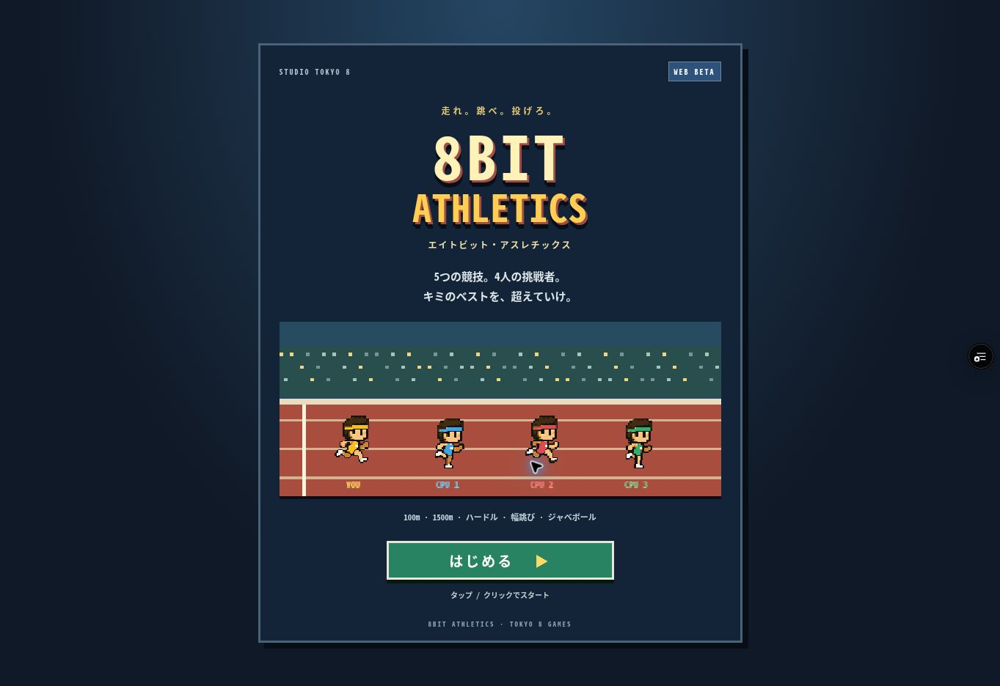

# オープニング画面

実装: ea8c27b5c9b81882fe5805d1fb4c0206e454bd84
対象: feature/8bit-athletics-web-beta / games/athletics

ロゴ画面 → ストーリー3場面 → ゲーム（競技選択）の順に遷移。
ロゴは対象フォルダに専用画像がなかったため既存タイトルの文字を装飾。選手は承認済みPNGをそのまま使用し、タイトルでは走行を再生。自動で次画面には進まない。

ストーリーは「ライバルとの出会い」「5種目への挑戦」「スタートラインへ」の3場面。文字送り、全文表示、次へ、スキップ。OSの動きを減らす設定では全文表示・選手の静止に対応。

オープニング中は競技の時間を進めず、A/Bの入力をゲームへ渡さない。タイトル復帰時は競技状態と押下状態をリセット。ゲーム再入場時は描画時計を更新する。

## 検証

クラウドChromeで実際に操作・描画確認:
- タイトル → 3場面 → 競技選択 → START → 操作説明 → 位置について
- 文字送り完了、全文表示、次へ
- 競技からタイトルへ戻る → はじめる → スキップ → 競技選択
- 390×844、820×1180 CSS pxのiframeによる幅確認。実機・端末エミュレーションではない。
- 既存競技206項目PASS（タイム・得点・胸部判定・駆け抜け・大会進行）

プレビュー: https://tokyo8games-ecr9r1826-tokyo8games.vercel.app/games/athletics/

変更: index.html、opening.css、tests/probe.js、tests/motion-probe.js、本報告と証跡画像。本番main・他ゲームは未変更。

