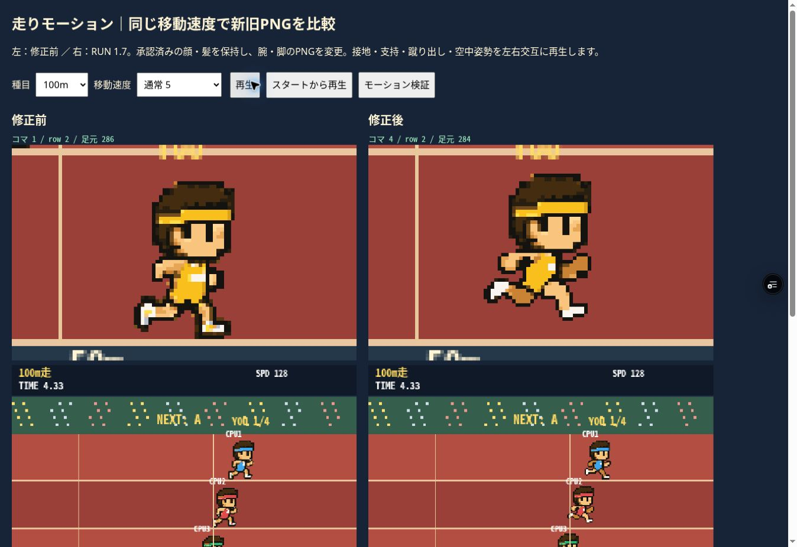

# RUN 1.7 — 走行PNGの修正

対象: feature/8bit-athletics-web-beta / games/athletics のみ。
実装コミット: a0c0c451b0071aa76c556f81fee4c41adebc3b1d。

## 原因と変更

RUN 1.6は再生周期の修正のみで、元の走行PNGは脚を広げた似た姿勢が多く、支持・膝上げ・左右の交代が読みにくかった。

- sprint_right.png: 接地→支持と脚の回収→蹴り出しと膝上げ→空中姿勢を左右交互に8コマ化。腕と脚のPNG自体を更新。
- jog_right.png: 同じ新しい動作から6コマを使用。
- 全コマの頭部（0〜23行）は、承認済みsprintの先頭コマとRGBAが完全一致。頭の横揺れを解消。
- 新しい身体を元の13色に量子化。アルファは0/255のみ。白い靴を保持し、外周の灰色を追加していない。
- 48×48のフレーム寸法を維持。胸の描画基準点は新PNGに合わせ29pxへ統一し、画面上の胸の判定位置を維持。
- 接地・支持時の上下動を抑え、空中姿勢だけ2px上昇。1500mは1px。
- 移動速度、操作、距離、得点、タイム確定、大会進行は変更なし。
- 比較ページに旧PNGを固定保存し、新旧を同じ移動速度・同じ経過時間で表示。

## 検証

クラウドChromeの実際のCanvas表示で実施。物理PC・iPhone・iPadの実機確認ではない。今回は端末エミュレーションも未実施。

- 100m全8コマ、1500m全6コマを明暗背景で目視。白い外周残りなし。
- 100m連続再生、CPUの青・赤・緑、ゴール演出終了後の駆け抜けを画面で確認。
- モーション検証16項目PASS: スタート3コマ、速度別全8コマ、上限12fps、30/60fps一致、停止、ゴール後継続、再挑戦リセット。
- 回帰検証206項目PASS: 全コマ整数描画、胸部判定、タイム固定、右への駆け抜け、再挑戦、全5種目、大会の得点・進行。
- 同一入力シミュレーションで100m 19.55秒/831点、1500m 9.05秒/1000点、ハードル8.57秒/1000点、大会3685点が旧版と一致。この数値は自動検証用入力によるもの。
- 他種目・正面ポーズの専用PNGは変更なし。幅跳びの専用モーション制作は今回の対象外。

実際に確認したプレビュー:
https://tokyo8games-6uiphpsuv-tokyo8games.vercel.app/games/athletics/

動く比較:
https://tokyo8games-6uiphpsuv-tokyo8games.vercel.app/games/athletics/tests/motion.html

同一時刻・同一移動速度の比較画像:

## 変更ファイル

- assets/sprites/approved_v15/{sprint_right.png,jog_right.png,manifest.json}
- index.html
- tests/motion.html、tests/visual.html
- tests/motion-baseline/index.html と旧sprint/jog PNG
- tests/evidence/running-v17.jpg、本報告
