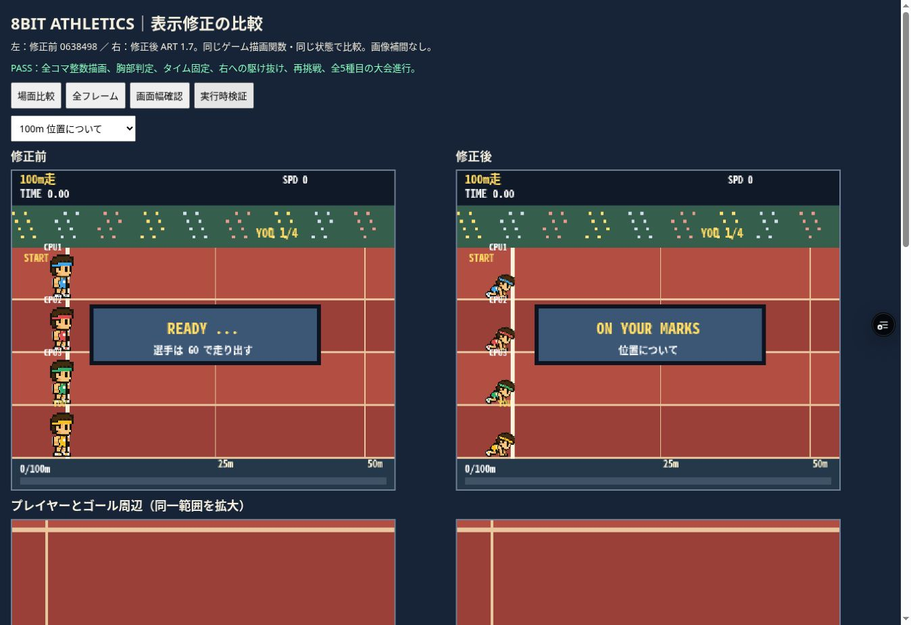

# RUN 1.8 スタート順序と合図音

原因: 従来はready中に待機画像を表示し、移動開始後にstart_rightの0/1/2コマを再生していた。
修正: 100mとハードルは位置について（既存0コマ、1.5秒）→用意（既存1コマ、1.5秒）→号砲（既存2コマ、0.12秒）→走行。1500mは立ったまま待機する。途中停止後に構えのコマを再生しない。

Web Audioによる合図: 位置について440Hz、用意660Hz、号砲0.18秒の減衰ノイズ。START操作でAudioContextを有効化し、ON/OFFボタンを追加。音声読み上げではなく効果音。

ブラウザChromeでモーション38項目、競技回帰206項目PASS。全員の号砲前の静止、計測停止、発走、再挑戦の初期化を含む。表示比較で位置について・用意を目視。実ゲームの開始操作と音ON/OFF表示を確認。
実機のスピーカー出力・聞こえ方、およびスマートフォン端末エミュレーションは未確認。

変更: index.html、tests/motion-probe.js、tests/probe.js、tests/visual.html、tests/motion.html。PNG変更なし。本番mainへの反映なし。
実装4eea184、検証修正d6588d3。

検証URL: https://tokyo8games-hci155b1p-tokyo8games.vercel.app/games/athletics/

